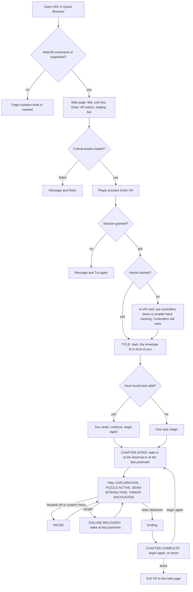

# UX flow

From opening the URL to the end of the chapter. Game states in capitals are defined in `04-engineering/runtime-lifecycle.md`.

## 1. Flow

## 2. Screens and surfaces

### The web page (before VR)

A dark page with the title, the one-line pitch, a loading bar and a single button. It states: seated, hands only, about seven minutes, headphones recommended. It is the only place with conventional UI.

| Condition | The page shows |
|---|---|
| No WebXR or no `immersive-vr` | "This needs a VR headset browser. Open this address in the Meta Quest Browser." (REQ-ERR-001) |
| Loading | Bar and "Preparing the house" |
| Critical asset failed | What failed in plain words, and Retry (REQ-REL-004) |
| Ready | Enter VR |
| Session refused | "The headset did not start VR. Try again." (REQ-ERR-002) |
| Returned from VR | Enter VR again; progress is kept |

### Title (in VR)

Darkness with a faint sense of a very large room. The envelope floats at chest height 0.45 m in front, lit by one warm source. Its wax seal glows. Pressing the seal with a fingertip begins. If a save exists there are two seals, one intact (continue) and one broken and re-pressed (begin again). No text other than the envelope's own.

This doubles as the first interaction lesson: a fingertip press, with no stakes.

### The envelope (during play)

The only interface (REQ-UX-005).

| Side | Shows |
|---|---|
| Front | ROOM 0. *Return before the house closes.* |
| Back, top | Postmarks, in order earned |
| Back, middle | One hint line in ink, when earned by idling |
| Back, lower edge | Chalk tallies, one per time caught |
| Back, flap | Four wax seals: snap turn, intensity, hands, begin again |

### In-VR cards

Two only, both rare, both a plain cream card held 0.6 m ahead that follows the head lazily and never blocks the hands:

- hands not tracked;
- an unrecoverable error, with a seal to restart (REQ-REL-003).

## 3. First ninety seconds

| Time | Player sees | Player does | Learns |
|---|---|---|---|
| 0:00 | The envelope and its glowing seal | Presses the seal | Fingertips work |
| 0:05 | Fade to the doormat; the hall; the letter in hand | Looks around | Scale |
| 0:20 | A tape rasp in the wall | Listens | Something else is here |
| 0:25 | One small lamp glowing by the north door | Points and pinches | How to move |
| 0:35 | The door, the gap, the offset stair, a pulsing brass grip | Reaches and pinches | Brass is for hands |
| 0:45 | The stair wing sliding as the hand moves | Slides | I move the house |
| 0:55 | A ring of light round the doorway | Lets go | Light means it will join |
| 1:00 | The thud; a new lamp at the top of the stair | Hops | The house changed, so my route changed |

## 4. Attention and sight lines

At every vantage, in this order of salience:

1. The station grips, in the lower centre of view, the only brass at hand height.
2. The goal across the void, lit.
3. The lamps for available hops, at the edges.
4. The Surveyor, when present, always backlit so that its silhouette reads at distance.

Nothing gameplay-relevant is placed behind the player, above 40 degrees of elevation, or below 30 degrees of depression.

## 5. Interruption and return

| Interruption | On return |
|---|---|
| Headset removed for seconds | Exactly where you were; the Surveyor has not moved |
| Session ended from the system menu | The web page; Enter VR resumes at the last postmark |
| Browser tab reloaded or closed | Title offers continue from the last postmark |
| Save unreadable | Title offers begin only, and a small line on the envelope's back: "The postmarks have faded." (REQ-ERR-004) |

## 6. Ending and exit

After the ending the title appears in the air of Room Zero and the envelope on the desk shows two seals. Begin again resets everything, including tallies. Leave ends the session and returns to the web page.
