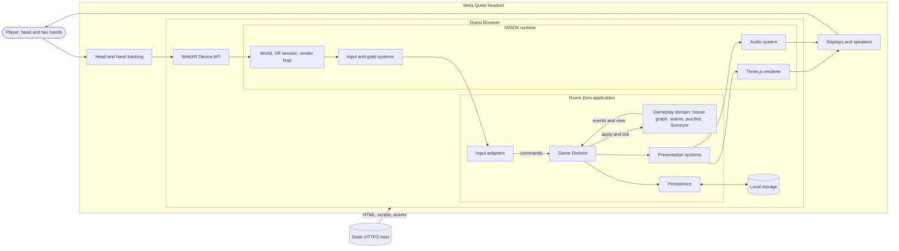
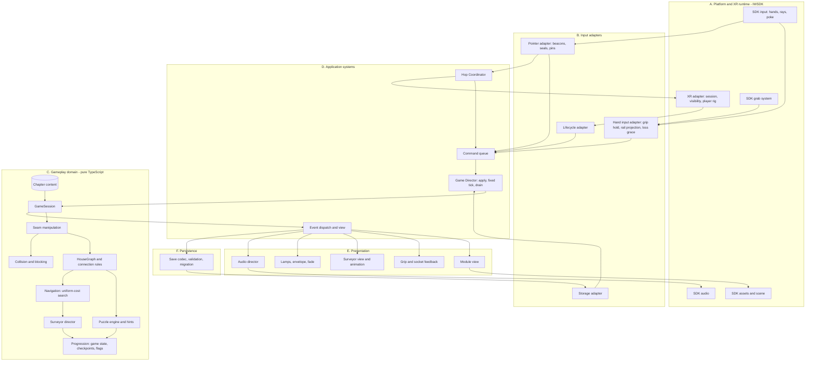
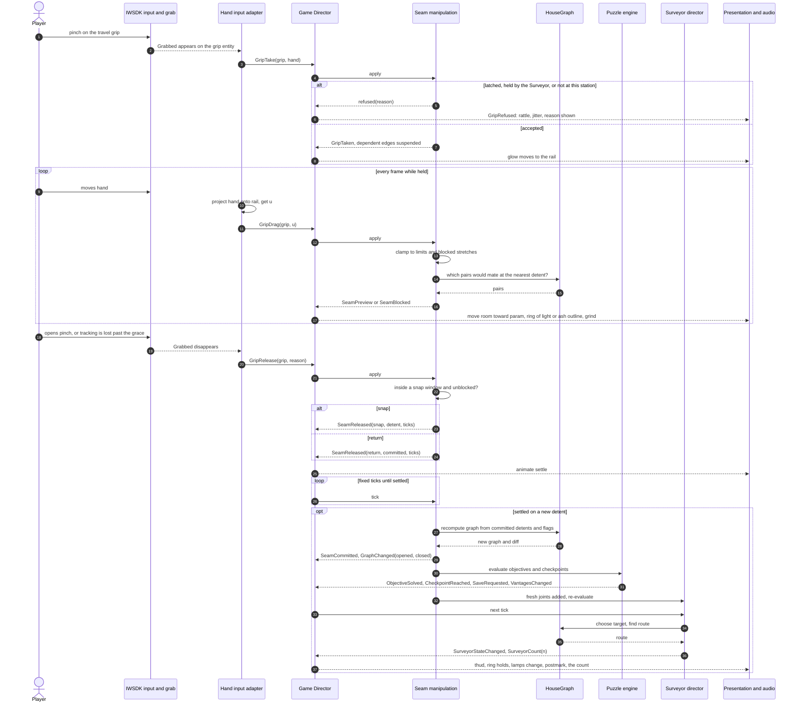
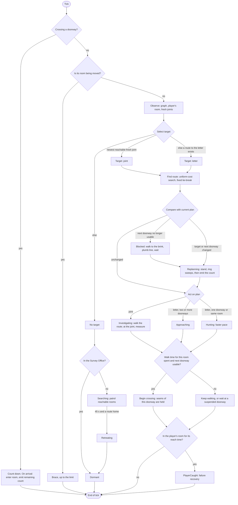
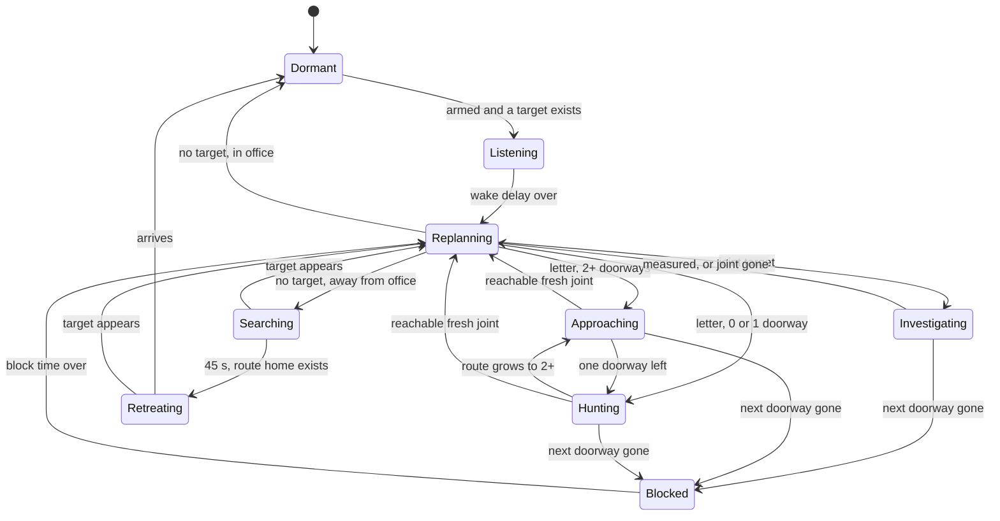
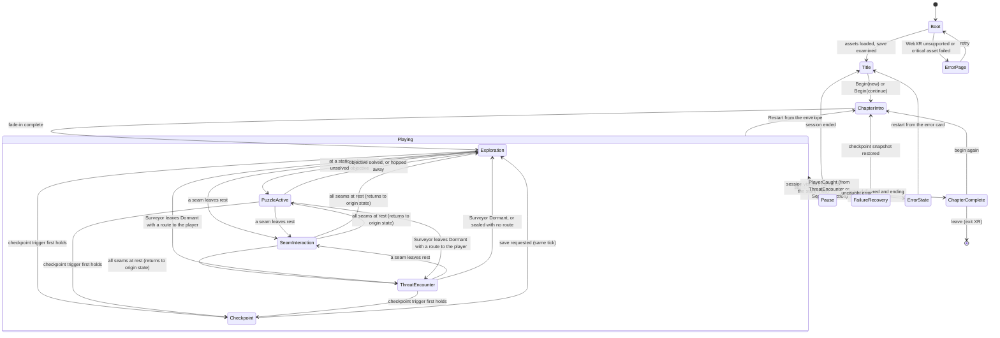
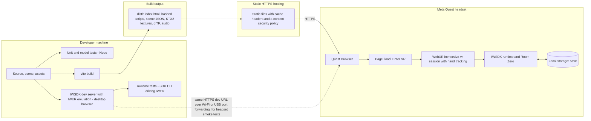

# Architecture diagrams

All required diagrams in one place. Each is the picture of text that exists elsewhere; if a diagram and its source document differ, the document is right.

## 1. System context

Source: `technical-architecture.md` section 2.

## 2. Component architecture

Source: `system-components.md`.

Arrows show the direction of calls or data. No arrow leaves the domain toward any other layer: the domain is called, and answers with events and a view.

## 3. Interaction sequence: one seam move

Source: `technical-architecture.md` section 12; `domain-model.md` section 6.

## 4. Enemy decision sequence

Source: `01-game-design/enemy-surveyor.md`; `domain-model.md` section 7.

Surveyor states only:

## 5. Game-state machine

Source: `runtime-lifecycle.md` section 3.

Failure conditions and their recovery routes: unsupported platform and failed critical load go to the error page with retry; a caught player goes through FailureRecovery to the last checkpoint; a lost session goes through Pause to Title and resumes from the last checkpoint; an uncaught error goes to the error card and restarts; a rejected save is handled before Title by the recovery ladder in `save-schema.md`.

## 6. Deployment architecture

Source: `build-architecture.md`.

IWER is a development and test environment. It emulates the WebXR device in a desktop browser and is not a substitute for a physical headset: it does not reproduce tracking quality, comfort, display characteristics or device performance. Validation on hardware is a separate gate (`05-quality/test-strategy.md` section 8).

## 7. Save recovery

See `save-schema.md` section 5.

## 8. Player flow

See `02-experience-design/ux-flow.md` section 1.
