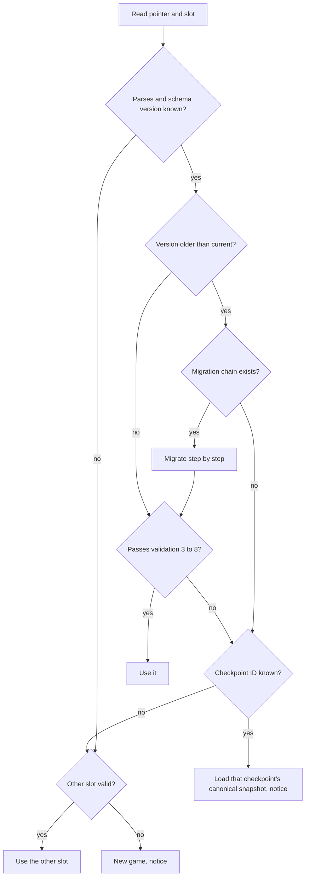

# Save schema

## 1. Principles

- Local only: the browser's local storage for the site's origin. No account, no network (REQ-SAVE-003).
- Small: one record under 8 KB (REQ-SAVE-007).
- Checkpoint-grained: the game saves at postmarks, on completion and when a setting changes. It never saves mid-pursuit (REQ-SAVE-006).
- Untrusted on load: validated fully before use (REQ-SEC-003, REQ-SAVE-004).
- Never fatal: a bad save degrades to an earlier, known-good state (REQ-SAVE-005).

## 2. Storage layout

| Key | Value |
|---|---|
| `rz.save.pointer` | `"A"` or `"B"`: which slot is current |
| `rz.save.A`, `rz.save.B` | A JSON record |
| `rz.settings` | Settings only, so they survive a rejected save |

A write goes to the slot that is not current, is read back and parsed, and only then is the pointer switched. A crash or quota error mid-write leaves the previous record intact.

## 3. Record, schema version 1

```json
{
  "schemaVersion": 1,
  "contentVersion": "chapter-one@1",
  "chapter": "chapter-one",
  "checkpoint": "cp-east",
  "seams": {
    "seam-hall": 1, "seam-landing": 2, "seam-rotunda": 1,
    "seam-bridge": 0, "seam-lift": 1, "seam-arm": 0
  },
  "flags": { "surveyorArmed": true, "houseClosing": false },
  "solved": ["obj-first-seam", "obj-staircase", "obj-wrong-door", "obj-bridge"],
  "edges": [
    "bridge.free|c-west.end", "bridge.pivot|c-east.west", "c-east.end|lift.near",
    "c-west.mouth|turn.f1", "foyer.north|stair.foot", "landing.east|turn.f3",
    "landing.west|stair.head"
  ],
  "surveyor": {
    "state": "Searching", "room": "dead-letter",
    "freshJoints": [{ "edge": "bridge.free|c-west.end", "measureIn": "c-west" }]
  },
  "catches": 1,
  "complete": false,
  "settings": { "snapTurn": 0, "intensity": "standard", "hands": "two", "mirrored": false }
}
```

Field notes:

| Field | Notes |
|---|---|
| `schemaVersion` | Integer. Changes when the shape of the record changes |
| `contentVersion` | Changes when chapter data changes in a way that could invalidate a save: IDs, detent counts, checkpoints |
| `seams` | The committed detent of every seam. Module transforms are derived from these; no pose is stored |
| `edges` | Open edge IDs, sorted. Redundant by design: it is recomputed from `seams` and `flags` on load and must match |
| `surveyor` | Its state at the checkpoint boundary only. The record never holds a mid-crossing position |
| `settings` | Duplicated in `rz.settings` |

Always-open edges such as `c-east.north|den.door` are omitted from the example for brevity; the real list contains every open edge.

Not stored: head or hand poses, timestamps, device information, hint timers, the letter's position, anything that identifies a person (REQ-SEC-002).

## 4. Validation on load

All must pass, in this order. Any failure goes to the recovery ladder with a reason.

1. The pointer names a slot; the slot exists and parses as JSON.
2. `schemaVersion` is a known integer.
3. The record matches the schema for that version: required fields present, types correct, no unknown top-level fields, strings under length limits, arrays under size limits.
4. `chapter` and `contentVersion` are known.
5. Every seam ID exists and every detent index is in range. Every checkpoint, flag, objective, module and edge ID exists.
6. **Graph equality:** the graph recomputed from `seams` and `flags` has exactly the edges listed.
7. **Rule checks:** the invariants of `domain-model.md` section 11 hold for the reconstructed state; the Surveyor's room exists; if it is not Dormant then `surveyorArmed` is set.
8. **Plausibility:** the checkpoint's own trigger predicate is satisfied by the record, and the state is one from which the chapter can be completed. The second part is a lookup in a table of safe configurations generated by the softlock check (MC-01) at build time.

## 5. Recovery ladder



- **Migration.** A function per version step, `v1 -> v2`, pure and tested with fixtures of real old records. A record newer than the build is not migrated downward; it goes to the canonical-snapshot step.
- **Canonical snapshot.** Each checkpoint's snapshot ships with the build and is valid by construction. Using it keeps the player's place in the chapter while discarding whatever was wrong.
- **Content version changed.** Treated as a validation failure at step 4 unless a content migration exists, so it normally lands on the canonical snapshot of the same checkpoint. If that checkpoint no longer exists, new game.
- **Notice.** When anything other than the stored record is used, the envelope shows one line once: "The postmarks have faded." (REQ-ERR-004). Settings are kept.

## 6. Writes

| Trigger | Written |
|---|---|
| `CheckpointReached` | Full record |
| Chapter complete | Full record with `complete: true` |
| A setting changes | `rz.settings`, and the current record's settings |
| Restart | Full record at `cp-arrival`, keeping settings |

Being caught does not write the Surveyor's position. It increments `catches` in the current record.

If local storage is unavailable or full, the game continues without saving and says so once on the web page after the session. Nothing in play depends on a write succeeding.

## 7. Tests

UT-SAVE-01 round trip; UT-SAVE-02 migration fixtures; UT-SAVE-03 tampered and malformed records, including a seam index out of range, an edge list that does not match, an unknown ID, an oversized string, and a truncated file; UT-SAVE-04 each rung of the ladder; UT-SAVE-05 size; UT-SAVE-06 field whitelist. RT-18 and RT-19 exercise real storage in the browser.
