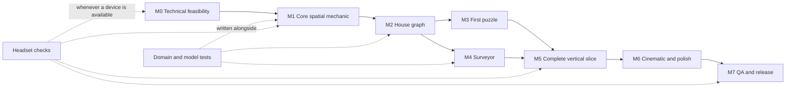

# Implementation roadmap

Eight milestones. Each ends with something that runs and with evidence at a stated level. There are no dates: nothing is known yet about team size or hours, and a schedule written now would be invented. Each milestone has a complexity estimate instead, with the reason for it.

**Complexity scale.** S: a few focused sessions for one developer. M: roughly a working week. L: several weeks. XL: dominated by content production, not code. These are relative sizes for planning order, not commitments.

**Rule of the roadmap.** Risk first. The things most likely to invalidate the design, hands on a real headset and the SDK's actual behaviour, are tested before anything is built on them.

## Sequence and dependencies

M3 and M4 can proceed in parallel after M2, since the Surveyor's domain needs only the graph.

## M0 — Technical feasibility

**Goal.** One fixed room, one moving room, one seam, two sockets, one grab, in VR, with hands.

**Work.**
- Generate the project with the official generator inside this directory. Record versions. Decide which generated tooling to keep.
- Confirm the unchanged starter enters XR under IWER and, if a headset is available, on the headset.
- Add the test runner and the import-rule script.
- Build the spike scene with graybox boxes: a room, a second room on a 2 m slide, one travel grip on a rail.
- Implement the thinnest vertical path: hand adapter, a two-detent seam in a minimal domain, module view.
- Test every assumption A1 to A11 in `04-engineering/iwsdk-verification.md` and write down the answers.

**Acceptance.**
- The versions ledger is filled from the lockfile.
- RT-01, RT-03, RT-04, RT-06, RT-07 and RT-08 pass under IWER against the spike scene.
- Each of A1 to A11 is marked true or false with how it was tested, and the hand interaction plan (P1, P2 or P3) is chosen.
- If a headset is available: HQ-01 passes, a first reading of HQ-02 is recorded, and PF-01 is read on the spike scene.
- An ADR is added or amended for anything the spike overturned.

**Evidence level reached.** IWER-verified for one seam; Quest-tested for one seam if hardware is available.

**Complexity.** M. Little code; the cost is in learning the SDK's real behaviour and the test tooling. Highest uncertainty of any milestone.

**Exit decision.** Continue as designed, or change the input plan, or, if hands cannot hold a grip reliably, make the latch-pin mode the default.

## M1 — Core spatial mechanic

**Goal.** Seam manipulation complete for one seam of each kind: linear, rotary lever, ratchet, and latched.

**Work.**
- Domain: seam state machine, guards, clamping, snapping, return, settle, ratchet, latch, forced and lost release.
- Hand adapter: line and arc projection, loss grace, leave-rail.
- Presentation: damped follow with speed cap, grip states, latch, first-pass feedback sounds and the ring of light.
- Connection rule for a single socket pair, with preview.

**Acceptance.**
- UT-SEAM-01 to UT-SEAM-03, UT-SEAM-05, UT-SEAM-06, UT-SEAM-09, UT-SEAM-11 to UT-SEAM-13, UT-CONN-01 to UT-CONN-04 and UT-ADPT-01 to UT-ADPT-03 pass.
- RT-05 and RT-11 pass under IWER.
- On a headset if available: HQ-03 and HQ-05 first readings; a team comfort check of a 14 m room crossing (CF-03, informal).

**Complexity.** M to L. The rules are straightforward; the feel, and behaviour under real tracking loss, will need iteration.

## M2 — House graph

**Goal.** All eleven modules as graybox, all six seams, the full graph, hops.

**Work.**
- Content for chapter one: modules, sockets, pair rules, seams, vantages.
- Domain: graph computation, diff, edge attributes, suspension, collision and blocked stretches, content validation, invariants.
- Hop coordinator, fade, beacons, vantage anchors, the startup join check.
- Debug overlay drawing the graph.

**Acceptance.**
- UT-GRAPH-01 to UT-GRAPH-06, UT-CONN-05, UT-CONN-06, UT-SEAM-04, UT-SEAM-07, UT-SEAM-10 pass.
- INS-01 to INS-03 run in the test script and pass.
- RT-09, RT-10 and RT-22 pass under IWER.
- The player can hop through the whole house in graybox by setting seams, with no puzzles or enemy.

**Complexity.** L. The largest block of domain code and all the content authoring. Collision volumes and socket poses must be right in two places.

## M3 — First puzzle

**Goal.** Sequences 1 and 2 playable from the title: the envelope, onboarding, the first seam, the Missing Staircase, checkpoints and save.

**Work.**
- Game state machine, title, chapter intro, checkpoints, canonical snapshots.
- The letter: hold, strap, postmarks, hints, seals.
- Puzzle engine with objectives as data.
- Persistence: codec, validation, recovery ladder.
- Pause and resume; session exit and re-entry.
- Automated draw-call and triangle gate.

**Acceptance.**
- UT-PUZ-01, UT-PUZ-04 to UT-PUZ-06, UT-STATE-01, UT-STATE-02, UT-STATE-04, UT-STATE-05, UT-SAVE-01 to UT-SAVE-06 pass.
- RT-02, RT-12, RT-13, RT-16, RT-18, RT-19 pass under IWER.
- An informal first-time-user check of the first ninety seconds with two people, on a headset if available (PT-01, informal).

**Complexity.** M to L. Many small systems; persistence and lifecycle are where subtle bugs live.

## M4 — Surveyor

**Goal.** The Surveyor's domain complete and the encounter playable in graybox.

**Work.**
- Domain: state machine, target selection, routing, fresh joints, crossing and holding of seams, brace, catch, failure recovery.
- Model checks MC-01 to MC-05.
- Presentation: a graybox figure placed along in-room paths; ring direction; the count as sound and chalk; state sounds; minimum distance.
- Audio attenuation by route.

**Acceptance.**
- UT-SURV-01 to UT-SURV-13, UT-SEAM-08, UT-STATE-03, UT-ADPT-04 pass.
- MC-01 to MC-05 pass.
- RT-14 and RT-20 pass under IWER.
- The encounter can be played and won in graybox by someone who has read the rules.

**Complexity.** L. The logic is small but must be exactly right, and the model checker is new work. Tuning needs players.

## M5 — Complete vertical slice

**Goal.** The whole chapter in graybox, start to ending, restartable, hands only.

**Work.**
- Sequences 3 and 5: the Turning Room, the lift and arm.
- The ending sequence and Room Zero, graybox.
- One-handed mode, reduced intensity, snap turn.
- Error boundary and cards.
- First full playtest and comfort round.

**Acceptance.**
- UT-PUZ-02 and UT-PUZ-03 pass; all UT and MC pass.
- RT-01 to RT-24 pass under IWER.
- On a headset: HQ-01 to HQ-07 pass; PF-01, PF-04 and PF-05 are measured on graybox; a playtest round (PT-01 to PT-05) and a comfort round (CF-01 to CF-07) are run and their findings recorded.
- **Scope review:** with playtest and performance evidence in hand, confirm or cut content before any final art is made (risk R-15).

**Current status (2026-11-18).** Graybox implementation is complete; the targeted IWER gate has passed, 22 of 24 recorded IWER runtime rows pass, and one hand-driven IWER chapter completion reached the ending. RT-01, RT-15, three fresh-profile completions, headset measurements, first playtest and comfort round remain open; M5 is not formally closed. See `docs/05-quality/interaction-test-matrix.md`, `docs/05-quality/runtime-test-results.md`, `docs/07-delivery/verification-status.md` and `docs/07-delivery/known-limitations.md`.

**Evidence level reached.** IWER-verified for the whole chapter. Quest-verified in graybox if hardware is available.

**Complexity.** L. Mostly integration. The playtest findings will generate rework that cannot be estimated in advance.

## M6 — Cinematic and polish

**Goal.** The chapter looks and sounds like the art direction.

**Work.**
- The architectural kit, textured, with baked lighting per room.
- Courier-scale fittings, the letter, Room Zero.
- The Surveyor: model, textures, animation clips.
- All audio; mix.
- Dust, lamp flicker, void rooms, the closing.
- Final onboarding and feedback tuning.

**Acceptance.**
- Every row of the asset register has a source; INS-04 and INS-05 pass.
- Every event in `interaction-feedback.md` has its visual and audio response; INS-10 passes.
- PF-02 and PF-03 pass; PF-01 is re-measured per room as art lands and stays within budget.
- Each sight line in `environment-design.md` section 5 is checked on a headset.
- HQ-08 and HQ-09 pass.

**Complexity.** XL. Content production dominates and depends entirely on who makes it. This is the milestone most likely to be reduced in scope; the cut list is in the risk register under R-15.

## M7 — QA and release

**Goal.** A release build with evidence.

**Work.**
- Full regression of UT, MC, INS and RT.
- Full performance plan, three runs each.
- Second playtest and comfort rounds on the release build.
- Production build, hosting, content security policy.
- Name and trademark check before anything public.
- Known limitations and evidence table updated.

**Acceptance.**
- The release checklist in `build-architecture.md` section 8 is complete.
- All eleven acceptance criteria are met at the "Accepted" level, or the level actually reached is stated.
- The definition of done is met.

**Complexity.** M, plus whatever the second playtest finds.

## What can be done with no headset at all

M0 to M5 can reach IWER-verified. M6 can be produced and gated on scene counts. Nothing about performance, comfort, tracking or legibility can be claimed, and the project is reported as IWER-verified, not as a Quest title. See risk R-14.

## Order of first tasks

1. Decide whether a Quest 3 is available, and when (Q-19).
2. M0, in one sitting if possible: generate, verify the starter, build the one-seam spike, answer A1 to A5.
3. Put the spike on a headset before writing any more domain code.
